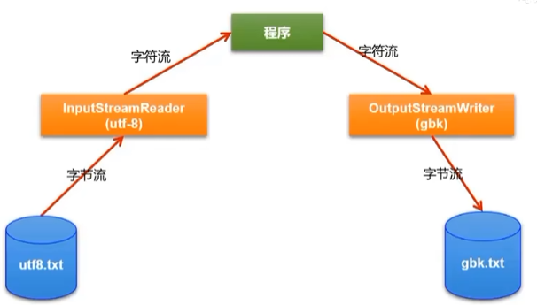

## 转换流

如果希望程序在读取文本文件时，不出现乱码，需要注意什么？

* 解码时使用的字符集必须与当初编码时使用的字符集相同。
* 拓展：解码集必须要与编码集兼容。比如：文件编码使用的是 GBK，解码时使用的是 utf8.如果文件中只有 abc123 等英文字符，此情况下也不会出现乱码，因为
  GBK 和 utf8 都向下兼容了 ASCII。

### 作用：实现字节与字符之间的转换

### API

* InputStreamReader：将一个输入型的字节流转换为输入型的字符流
* OutputStreamWriter：将一个输出型的字符流转化为输出型的字节流



```
try (
    // 读取：字节流 -> InputStreamReader(UTF-8) -> 字符流
    BufferedReader br = new BufferedReader(
        new InputStreamReader(new FileInputStream("utf8.txt"), "UTF-8")
    );
    // 写出：字符流 -> OutputStreamWriter(GBK) -> 字节流
    BufferedWriter bw = new BufferedWriter(
        new OutputStreamWriter(new FileOutputStream("gbk.txt"), "GBK")
    )
) {
    char[] buffer = new char[1024];
    int len;
    while ((len = br.read(buffer)) != -1) {
        bw.write(buffer, 0, len);   // 将读到的字符原样写出
    }
} catch (IOException e) {
    e.printStackTrace();
}
```

* 读取过程

```
内存
  ↕
BufferedReader      ← 最外层（靠近程序）
  ↕
InputStreamReader   ← 中间层（字节→字符）
  ↕
FileInputStream     ← 最内层（靠近文件）
  ↕
utf8.txt
```

* 写入过程

```
内存（字符）
   │
   ▼
BufferedWriter        ← 最外层，字符流，接收字符
   │  （字符）
   ▼
OutputStreamWriter    ← 中间层，字符 → 字节（按 GBK 编码）
   │  （字节）
   ▼
FileOutputStream      ← 最内层，字节流，直接写文件
   │  （字节）
   ▼
gbk.txt（磁盘上的字节）
```

总结：

* 包装顺序：内层先创建，外层后创建；外层包裹内层。

* 读：文件 → 内层 → 外层 → 程序。
* 写：程序 → 外层 → 内层 → 文件。

### 关于字符集的理解

#### 在存储文件中的字符：

* `ASCII`（American Standard Code For Information Interchange，美国信息交换标准代码）：
    * 主要用来存储大小写英文字符、数字、常用的英文标点符号等。
    * 基础的ASCII字符集使用7位（`bits`）表示一个字符（最前面的1位统一规定为0），共128个字符，每个字符占用 1 个字节。
    * 比如：空格 “SPACE” 是32 (二进制 00100000)，大写的字母 “A” 是65 (二进制 01000001)
* `iso-8859-1`：拉丁码表，别名Latin-1，主要用于显示欧洲使用的语言。每个字符占用1字节，兼容 ASCII。
* `GBK`：最常用的中文码表。在 GB2312 标准基础上的扩展规范，完全兼容了 GB2312。中文使用了双字节编码。
    * `GB2312`：早期使用 GB2312，简体中文码表。兼容 ASCII。大约包含7000多个简体字。
    * `GB18030`：最新的中文码表，采用多字节编码
* `utf-8`：可以使用存储世界范围内主要的语言的所有的字符。使用1-4个不等的字节表示一个字符。
    * 中文使用 3 个字节存储的。向下兼容 ASCII。

#### 在内存中的字符：

* 一个字符（char）占用2个字节。在内存中使用的字符集称为 Unicode 字符集。
    * 2^8 * 2^8 = 2^16 = 65536